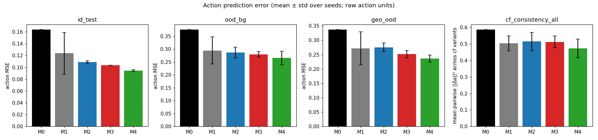

# 02 — Baseline results: M0–M4 on the synthetic 2-D reaching benchmark

All numbers in this file are produced by `python -m cort_mvp.export_report` from `results/runs/*/eval.json`
(machine-readable: `results/metrics/action_metrics.csv`, `results/metrics/summary_by_experiment.csv`; markdown tables in
`reports/tables/`). Checkpoints are selected on **validation (in-distribution) action MSE only**; OOD splits are never used
for selection or LR choice. Mean ± std is over 3 seeds (0, 1, 2) unless `n_seeds = 1`.

## 1. Setup recap

| item | value |
|---|---|
| data | `data_cache/reaching_v1` (seed 2026): train 10 000 states × 1 nuisance; val / id_test / ood_bg / geo_ood 2 000 each; cf_test 2 000 states × 4 nuisance variants (v0–v3) with identical state; `train_cf` (one extra nuisance per train state) is used **only** by M4 |
| visual nuisance | 9 background families (0–4 seen in train, 5–8 only in `ood_bg` / cf_test variants), 0–3 distractors, random halo, continuous (hue, hue2, sat, val, freq, phase, angle); see `01_dataset_validation.md` |
| features | frozen DINOv3 ViT-S/16 (`timm/vit_small_patch16_dinov3.lvd1689m`, rev `3bf4720a…`) CLS token, 384-d, cached once; DINOv2 ViT-S/14 for ablation D |
| action | `a = clip(K·(goal − ee), ‖a‖≤1.5)`, K = 1, reported in raw action units; actions are z-scored (train mean/std) for the losses |
| latent | 64-d; fixed orthonormal action embedding `W ∈ R^{64×2}` (seeded QR) → action plane `span(W)` |
| velocity net | upstream VITA `SimpleFlowNet` (3 adaLN-MLP blocks, hidden 256) — 2 728 000 params; projector = `LayerNorm(384) → Linear(384,64)` = 24 640 params; **total 2 752 640 for M1, M2, M3 and M4** (identical) |
| optimiser | AdamW, wd 1e-4, batch 256, 6 000 steps, 200 warm-up, cosine; eval every 250 steps; best-val checkpoint |
| LR | per-model sweep on seed 0 over {3e-4, 1e-3, 3e-3, 1e-2} (`results/metrics/lr_sweep_table.json`) — selected on val MSE: M1 1e-2, M2 3e-3, M3 3e-3, M4 1e-3 |
| ODE | Euler, left-endpoint grid `t_k = k/n`, n = 8 at train and default eval; eval sweep over n ∈ {1, 4, 8, 16} |

Models (see `cort_mvp/models/`):

* **M0** ridge regression (RidgeCV, 5-fold on train) from frozen CLS features to actions.
* **M1** direct regression: same `SimpleFlowNet` evaluated once at constant `t = 0`, `â = Wᵀ z₁` (MSE on z-scored actions).
* **M2** endpoint-only ODE: the same net integrated for 8 Euler steps from `z₀ = P(h)`, loss only on the endpoint `MSE(Wᵀ z₁, a)`.
* **M3** paired cross-modal FM (VITA-style): `z_t = (1−t) z₀ + t·W a`, `u = W a − z₀`, loss `‖v_θ(z_t, t) − u‖² + MSE(Wᵀ z₁, a)` (λ = 1, 1) with `z₁` obtained by differentiable 8-step Euler integration (as in upstream VITA, so the endpoint loss also trains the projector).
* **M4** M3 + counterfactual invariance `‖z_t(h) − z_t(h′)‖²` on `train_cf` pairs at t ∈ {0.5, 1.0} (λ_cf = 1); **positive control** that uses privileged pairing information and is *not* a fair competitor.

LR sweep (val MSE, seed 0):

| model | 3e-4 | 1e-3 | 3e-3 | 1e-2 |
|---|---|---|---|---|
| M1 | 0.1432 | 0.1262 | 0.1139 | **0.1090** |
| M2 | 0.1392 | 0.1218 | **0.1080** | 0.1132 |
| M3 | 0.1444 | 0.1140 | **0.1052** | 0.1068 |
| M4 | 0.1236 | **0.0910** | 0.0927 | 0.1052 |

## 2. Main action-prediction results (3 seeds, best-val checkpoint, 8 Euler steps)

Action MSE in raw action units (chance / predicting the mean ≈ 0.42; the oracle is 0). `cf_consistency` is the mean
pairwise `‖â(v_i) − â(v_j)‖²` over the four nuisance variants of the same state in `cf_test` (0 = perfectly
nuisance-invariant predictions); `_unseen` restricts to pairs whose variants both use unseen background families.

| experiment | n_seeds | id_test | ood_bg | geo_ood | id angular (°) | ood_bg angular (°) | cf_consistency | cf_consistency_unseen |
|---|---|---|---|---|---|---|---|---|
| M0 ridge, DINOv3 CLS | 1 | 0.1640 | 0.3762 | 0.3375 | 32.65 | 52.04 | 0.5872 | 0.7682 |
| M0 ridge, DINOv3 patch-mean | 1 | 0.1698 | 0.3308 | 0.3429 | 34.69 | 53.13 | 0.5175 | 0.7021 |
| M0 ridge, DINOv2 CLS | 1 | 0.1922 | 0.3112 | 0.3645 | 38.34 | 50.26 | 0.4055 | 0.5769 |
| M1 direct regression | 3 | 0.1239 ± 0.0352 | 0.2947 ± 0.0526 | 0.2719 ± 0.0573 | 27.86 ± 4.23 | 47.05 ± 3.84 | 0.5034 ± 0.0452 | 0.6648 ± 0.0614 |
| M2 endpoint ODE | 3 | 0.1091 ± 0.0021 | 0.2869 ± 0.0208 | 0.2756 ± 0.0145 | 26.35 ± 0.26 | 44.68 ± 1.59 | 0.5144 ± 0.0551 | 0.6726 ± 0.0612 |
| M3 FM + endpoint | 3 | **0.1035 ± 0.0001** | 0.2801 ± 0.0103 | 0.2519 ± 0.0126 | 24.16 ± 0.17 | 45.68 ± 0.57 | 0.5122 ± 0.0358 | 0.6162 ± 0.0579 |
| M4 FM + CF invariance (positive control) | 3 | 0.0945 ± 0.0015 | 0.2654 ± 0.0263 | 0.2359 ± 0.0120 | 22.69 ± 0.34 | 47.33 ± 1.42 | 0.4729 ± 0.0552 | 0.5693 ± 0.0803 |

Per-seed values (action MSE):

| model | seed | val | id_test | ood_bg | geo_ood | best step | non-finite steps |
|---|---|---|---|---|---|---|---|
| M1 | 0 | 0.1090 | 0.1026 | 0.2706 | 0.2376 | 3500 | 0 |
| M1 | 1 | 0.1104 | 0.1045 | 0.2585 | 0.2401 | 3000 | 0 |
| M1 | 2 | **0.1699** | **0.1645** | **0.3551** | **0.3380** | 5999 | 0 |
| M2 | 0 | 0.1080 | 0.1070 | 0.2717 | 0.2628 | 2250 | 0 |
| M2 | 1 | 0.1136 | 0.1112 | 0.2783 | 0.2914 | 1500 | 0 |
| M2 | 2 | 0.1143 | 0.1091 | 0.3106 | 0.2726 | 2000 | 0 |
| M3 | 0 | 0.1052 | 0.1034 | 0.2708 | 0.2514 | 3500 | 0 |
| M3 | 1 | 0.1040 | 0.1035 | 0.2912 | 0.2396 | 4000 | 0 |
| M3 | 2 | 0.1082 | 0.1036 | 0.2783 | 0.2648 | 3500 | 0 |
| M4 | 0 | 0.0910 | 0.0941 | 0.2569 | 0.2371 | 4500 | 0 |
| M4 | 1 | 0.0950 | 0.0962 | 0.2948 | 0.2234 | 4500 | 0 |
| M4 | 2 | 0.0913 | 0.0933 | 0.2444 | 0.2473 | 4250 | 0 |

### Reading

* **All learned heads beat ridge on frozen features** (0.164 → 0.10–0.12 ID), i.e. the task is non-trivial from frozen DINO
  features but learnable; every model degrades strongly under unseen backgrounds (×2.6–2.8) and under geometric
  extrapolation (×2.3–2.5). The frozen-feature bottleneck dominates OOD behaviour for all heads.
* **M3 vs matched controls (ID):** M3 0.1035 ± 0.0001 vs M2 0.1091 ± 0.0021 vs M1 (two stable seeds) 0.1036. The M3–M2 gap
  (≈ 0.006, ≈ 5 %) is larger than the seed spread, but M3 is **indistinguishable from stable M1 seeds** (0.1026 / 0.1045).
  The angular error tells the same story (M3 24.2° vs M1 27.9° ± 4.2 incl. the unstable seed; stable M1 seeds ≈ 25–26°).
* **OOD:** M3 0.280 ± 0.010 (ood_bg) / 0.252 ± 0.013 (geo) vs M2 0.287 ± 0.021 / 0.276 ± 0.015 vs M1 0.295 ± 0.053 /
  0.272 ± 0.057. Differences are inside one seed-std for ood_bg; M3 is ≈ 0.02 better than M2 on geo_ood (≈ 1.5 std).
  No model is meaningfully more nuisance-consistent in its *predictions* (`cf_consistency` 0.50–0.51 for M1–M3; the
  positive control M4 only reaches 0.47).
* **M4 (privileged pairs)** gives the best ID (0.0945) and geo_ood (0.236) numbers but does *not* separate from M3 on
  ood_bg (0.265 ± 0.026 vs 0.280 ± 0.010) and its unseen-family consistency (0.57 ± 0.08) is only slightly better than
  M3 (0.62 ± 0.06). Even explicit invariance supervision on seen backgrounds transfers weakly to unseen background
  families through frozen features.

### Recorded failures / instabilities

* **M1 seed 2 at the selected LR 1e-2 did not converge** (final train loss, z-scored units, ≈ 0.37 vs 0.065 / 0.11 for
  seeds 0 / 1; val 0.170; best step = last step). All three M1 runs show transient val-MSE spikes to 2–3 during training
  (the selected LR is at the edge of stability for the regression head); no NaNs were produced. Seed 2 is **kept in all
  tables** (hence the large M1 std). As a documented robustness check the ablation suite re-trains M1 at the M2/M3 LR of
  3e-3 (`m1_lr3e-3_*`, §4).
* **Strong over-fitting for every learned head.** M2/M3 reach a training action loss of ≈ 0.002 (z-scored; ≈ 0.001 raw)
  while validation MSE plateaus at ≈ 0.105 raw: the heads memorise the 10 000 training states and the validation error is
  entirely generalisation gap. Early stopping on val is what makes the comparison meaningful; the FM loss (M3 train
  `loss_fm` ≈ 0.004) does not prevent the memorisation.
* **M1 residual-stream blow-up.** With `t ≡ 0` the adaLN time-modulation in `SimpleFlowNet` acts as a free bias and the
  final `LayerNorm` makes the output invariant to the residual-stream scale. The learned modulation gains reach
  `γ ≈ 4·10⁴` and the M1 hidden activations `h1–h3` have magnitude ≈ 10⁷ (seed 0) to 2·10¹⁰ (seed 2), with effective rank
  ≈ 1–2, while M3's hidden stream stays at ≈ 6·10². Outputs and `z₀/z₁` are unaffected. Consequently M1's *intermediate*
  stages (h1–h3) are reported only after per-dimension z-scoring and are not interpreted as an analogue of transport time
  (see `03_mechanism_analysis.md`).
* No NaN/Inf losses occurred in any of the 12 main runs or the 16 LR-sweep runs (`nonfinite_loss_steps = 0`).

## 3. ODE step-count sweep at evaluation (models trained with 8 steps)

`reports/tables/table_step_sweep.md`, fig. `fig9_ode_step_sweep.png`. Action MSE, mean ± std over 3 seeds:

| experiment | eval steps | id_test | ood_bg | geo_ood |
|---|---|---|---|---|
| M2 | 1 | **4.5945 ± 0.6154** | 5.0661 ± 1.6415 | 4.7546 ± 0.4124 |
| M2 | 4 | 0.1228 ± 0.0083 | 0.2999 ± 0.0208 | 0.2872 ± 0.0074 |
| M2 | 8 | 0.1091 ± 0.0021 | 0.2869 ± 0.0208 | 0.2756 ± 0.0145 |
| M2 | 16 | 0.1091 ± 0.0019 | 0.2869 ± 0.0202 | 0.2767 ± 0.0174 |
| M3 | 1 | 0.1109 ± 0.0034 | 0.2966 ± 0.0182 | 0.2616 ± 0.0147 |
| M3 | 4 | 0.1040 ± 0.0006 | 0.2824 ± 0.0118 | 0.2521 ± 0.0132 |
| M3 | 8 | 0.1035 ± 0.0001 | 0.2801 ± 0.0103 | 0.2519 ± 0.0126 |
| M3 | 16 | 0.1030 ± 0.0004 | 0.2791 ± 0.0105 | 0.2516 ± 0.0125 |
| M4 | 1 | 0.1915 ± 0.0057 | 0.2850 ± 0.0033 | 0.3740 ± 0.0340 |
| M4 | 4 | 0.2138 ± 0.0229 | 0.3009 ± 0.0091 | 0.3639 ± 0.0298 |
| M4 | 8 | 0.0945 ± 0.0015 | 0.2654 ± 0.0263 | 0.2359 ± 0.0120 |
| M4 | 16 | 0.0952 ± 0.0030 | 0.2776 ± 0.0276 | 0.2394 ± 0.0196 |

This is the clearest *FM-specific* effect in the study: the FM loss makes the learned field **integration-step robust**
(one Euler step already gives 0.111 vs 0.1035 at 8 steps; 16 steps = 8 steps), whereas the endpoint-only field of M2 is
only meaningful at the step count it was trained with (1 step → MSE 4.6, 4 steps → +13 %). M4's intermediate-time
invariance loss breaks the straight-line structure again (1 or 4 steps → ≈ 2× error). In other words, what the FM
objective buys relative to endpoint supervision is a well-conditioned *velocity field* (a transport that is close to
straight), not a better endpoint. Train-time step-count variations (n_steps ∈ {1, 4, 16}) are in §4.

## 4. Ablations (A–F)

Full table: `reports/tables/table_ablations_action.md` (3 seeds each, same selection protocol; `n_seeds = 3` everywhere).
`[…]` marks the deviation from the main configuration. No run produced non-finite losses.

### A — ODE step count at train time (M2/M3 trained with n ∈ {1, 4, 16}; evaluated at their own n)

| experiment | id_test | ood_bg | geo_ood |
|---|---|---|---|
| M2 n=1 (≡ M1 at lr 3e-3, see note) | 0.1110 ± 0.0061 | 0.3135 ± 0.0419 | 0.2578 ± 0.0296 |
| M2 n=4 | 0.1119 ± 0.0011 | 0.2812 ± 0.0290 | 0.2606 ± 0.0383 |
| M2 n=8 (main) | 0.1091 ± 0.0021 | 0.2869 ± 0.0208 | 0.2756 ± 0.0145 |
| M2 n=16 | 0.1123 ± 0.0026 | 0.2700 ± 0.0233 | 0.2609 ± 0.0062 |
| M3 n=1 | 0.1144 ± 0.0058 | **0.2599 ± 0.0152** | 0.2476 ± 0.0131 |
| M3 n=4 | 0.1044 ± 0.0007 | 0.3013 ± 0.0254 | 0.2612 ± 0.0084 |
| M3 n=8 (main) | 0.1035 ± 0.0001 | 0.2801 ± 0.0103 | 0.2519 ± 0.0126 |
| M3 n=16 | 0.1035 ± 0.0017 | 0.2895 ± 0.0344 | 0.2493 ± 0.0128 |

Train-time step count is irrelevant for M2 (0.109–0.112) and for M3 once n ≥ 4 (0.1035–0.1044). M3 with a single step
(a one-shot regression `z₀ + v(z₀, 0)` regularised by the FM loss) is 10 % worse ID but the best M3 variant on unseen
backgrounds (0.260; differences ≈ 1–2 σ). Evaluation-step robustness (table `table_step_sweep.md`) holds for every M3
variant and for no M2 variant: e.g. M2 trained with 16 steps gives MSE 12.7 at 1 step; M3 trained with 1 step evaluated
with 16 steps gives 0.134. *Note:* with the residual parametrisation `z₁ = z₀ + f(z₀, 0)` the M1 model is **exactly** M2
with n = 1; the `m1_lr3e-3_*` and `m2_*_nsteps1` runs reproduce each other bit-for-bit, which also serves as a
determinism check of the pipeline.

### B — Loss decomposition on the shared architecture

| experiment | id_test | ood_bg | geo_ood | cf_consistency | 1-step eval MSE |
|---|---|---|---|---|---|
| M3 = FM + endpoint (main) | 0.1035 ± 0.0001 | 0.2801 ± 0.0103 | 0.2519 ± 0.0126 | 0.512 ± 0.036 | 0.111 |
| FM only (no endpoint loss; `â = Wᵀz₁`) | 0.1220 ± 0.0029 | **0.3895 ± 0.0079** | 0.2567 ± 0.0087 | **0.770 ± 0.053** | 0.118 |
| endpoint ODE + `‖z₁ − W a‖²` (no FM) | **0.1005 ± 0.0021** | **0.2647 ± 0.0403** | 0.2509 ± 0.0021 | 0.486 ± 0.058 | 3.07 |
| M1 + `‖z₁ − W a‖²` (direct regression) | **0.0992 ± 0.0018** | 0.2969 ± 0.0161 | **0.2322 ± 0.0206** | 0.530 ± 0.024 | n/a |
| M2 (endpoint only) | 0.1091 ± 0.0021 | 0.2869 ± 0.0208 | 0.2756 ± 0.0145 | 0.514 ± 0.055 | 4.59 |
| M1 (direct regression, lr 1e-2 / 3e-3) | 0.1239 ± 0.0352 / 0.1110 ± 0.0061 | 0.295 / 0.314 | 0.272 / 0.258 | 0.50 / 0.54 | n/a |

* **The FM loss alone is a poor action learner** (0.122 ID, 0.39 on unseen backgrounds — the frozen-ridge level — and
  the least nuisance-consistent predictions of any model), although it is perfectly step-robust.
* **Replacing FM by an explicit embedding target `‖z₁ − W a‖²` reproduces or beats M3** on the shared ODE architecture
  (0.1005 vs 0.1035 ID; 0.265 vs 0.280 ood_bg) and on the plain regression head (0.0992 ID, 0.232 geo — the best fair
  model in the study). It also removes M1's LR instability (all 3 seeds within 0.002). What it does **not** reproduce is
  integration-step robustness (3.07 at 1 step), which is therefore the only property specific to the FM loss.
* Interpretation: the FM target `u = W a − z₀` implicitly asks the whole 64-d endpoint to sit at the point `W a`, not just
  `Wᵀz₁ = a`. That extra constraint (zeroing the 62 directions orthogonal to the action plane) is a useful regulariser
  for the latent and explains the small M3 > M2 gap; it is available without any flow.

### C — Projector capacity (M2 vs M3, DINOv3)

| projector | M2 | M3 |
|---|---|---|
| linear (main) | 0.1091 ± 0.0021 / 0.2869 / 0.2756 | 0.1035 ± 0.0001 / 0.2801 / 0.2519 |
| frozen random (no trainable projector) | 0.2422 ± 0.0135 / 0.3528 / 0.4801 | 0.2527 ± 0.0089 / 0.4217 / 0.4539 |
| 2-layer MLP | 0.1149 ± 0.0010 / 0.2951 / 0.2570 | 0.1144 ± 0.0014 / 0.3188 / 0.2637 |

(id / ood_bg / geo.) With a frozen random projection both models lose most of their accuracy (0.24–0.25 ID — worse than
ridge on the full 384-d feature, 0.164, because the random 384 → 64 projection discards information) and M3 is **not**
better than M2; with an MLP projector the two are identical (0.1149 vs 0.1144) and both slightly worse than linear
(more over-fitting). The M3 > M2 margin exists only for the linear projector.

### D — Backbone: DINOv2 ViT-S/14 instead of DINOv3 ViT-S/16

| model | id_test | ood_bg | geo_ood |
|---|---|---|---|
| M0 ridge (DINOv2 CLS) | 0.1922 | 0.3112 | 0.3645 |
| M1 | **0.1470 ± 0.0041** | 0.2974 ± 0.0182 | **0.3031 ± 0.0024** |
| M2 | 0.1588 ± 0.0018 | 0.2959 ± 0.0188 | 0.3499 ± 0.0270 |
| M3 | 0.1549 ± 0.0034 | **0.2851 ± 0.0043** | 0.3340 ± 0.0416 |

DINOv2 features are worse for this task (ridge 0.192 vs 0.164) and the **ranking changes**: direct regression is best ID
and on geo_ood, M3 is best on unseen backgrounds by ≈ 1 σ. The ID ordering M3 < M2 < M1 seen with DINOv3 is thus
backbone-dependent, not a property of the FM objective.

### E — Training-set size (fraction of the 10 000 training states)

| model | 100 states (1 %) | 1 000 states (10 %) | 10 000 (100 %) |
|---|---|---|---|
| M1 | 0.4221 ± 0.0196 / 0.643 | 0.2016 ± 0.0077 / 0.395 | 0.1239 ± 0.0352 / 0.295 |
| M2 | 0.3845 ± 0.0336 / 0.519 | 0.2006 ± 0.0066 / 0.354 | 0.1091 ± 0.0021 / 0.287 |
| M3 | **0.3527 ± 0.0067** / 0.465 | **0.1792 ± 0.0061** / 0.342 | 0.1035 ± 0.0001 / 0.280 |
| M1 + emb (follow-up) | 0.4728 ± 0.0360 / 0.787 | 0.1902 ± 0.0008 / 0.449 | 0.0992 ± 0.0018 / 0.297 |
| endpoint + emb (follow-up) | 0.3524 ± 0.0047 / 0.415 | 0.2002 ± 0.0075 / **0.296** | 0.1005 ± 0.0021 / 0.265 |

(id / ood_bg; chance ≈ 0.42.) **The low-data regime is where FM helps most**: at 1 000 states M3 is 11 % better than
M1/M2 (consistent across seeds, ≈ 3 σ) and at 100 states 8–16 % better (all models are near chance ID). The follow-up
runs show this is only *partly* explained by the embedding target: `endpoint + emb` ties M3 at 100 states (0.352 vs
0.353) and is better on unseen backgrounds at 1 000 states (0.296 vs 0.342), but at 1 000 states M3 remains 6 % ahead of
the best non-FM variant ID (0.179 vs 0.190, ≈ 2 σ). `M1 + emb` degrades sharply at 100 states (0.47, worse than chance).

### F — Minibatch OT re-pairing (VITA's `ExactOptimalTransportConditionalFlowMatcher`) in M3

| pairing | id_test | ood_bg | geo_ood | 1-step | 16-step |
|---|---|---|---|---|---|
| paired (main M3) | 0.1035 ± 0.0001 | 0.2801 ± 0.0103 | 0.2519 ± 0.0126 | 0.111 | 0.103 |
| OT re-pairing | 0.1019 ± 0.0018 | 0.2894 ± 0.0163 | 0.2455 ± 0.0037 | 0.228 | 0.108 |

No accuracy difference (all within 1 σ). OT re-pairing destroys the step robustness (1 step: 0.228 vs 0.111) and makes
16 steps *worse* than 8, i.e. the field trained on re-paired targets is less straight per sample. In the upstream audit
(`00_repo_audit.md`) OT re-pairing moved ≈ 88 % of the plan mass off the diagonal; here it buys nothing.

### LR robustness check for M1

`m1_lr3e-3` (M2/M3's LR): 0.1110 ± 0.0061 ID, 0.3135 ± 0.0419 ood_bg, 0.2578 ± 0.0296 geo — all three seeds converge
(max 0.118). At a common LR the fair ordering ID is M3 0.1035 < M2 0.1091 < M1 0.1110 (7 % spread), and on ood_bg /
geo_ood the three overlap within 1 σ.

## 5. Summary for Q1 (action prediction part)

* FM (M3) is the best of the fair models on every split in the mean, but the margin over matched regression (stable M1
  seeds) is **zero within noise in-distribution** and ≤ 1–1.5 seed-std OOD. The margin over endpoint-only ODE (M2) is
  small (5 % ID, 3 % ood_bg, 9 % geo_ood) but consistent across seeds.
* M3 is far more **seed-stable** than M1 at their respective selected LRs (std 0.0001 vs 0.035) and far more
  **integration-step robust** than M2.
* The dominant failure mode (unseen backgrounds, geometric extrapolation) is shared by all heads and is not mitigated by FM;
  even the privileged M4 improves OOD only modestly.
* Ablations: the small M3 > M2 / M1 margin is reproduced or exceeded by adding the explicit latent target `‖z₁ − W a‖²`
  without any flow (B), disappears with an MLP or frozen projector (C) and reverses with DINOv2 features (D). The only
  regime with a consistent FM advantage not fully matched by the non-FM variants is the 1 000-state low-data setting
  (E, ≈ 6 % over the best non-FM model, ≈ 2 σ). OT re-pairing (F) brings nothing. Integration-step robustness is the one
  property that every FM variant has and no non-FM variant has.
* Linear decodability and nuisance geometry are addressed in `03_mechanism_analysis.md`.
