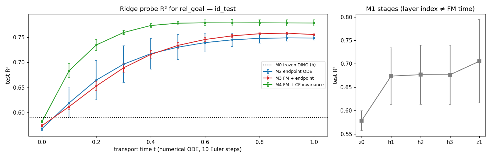
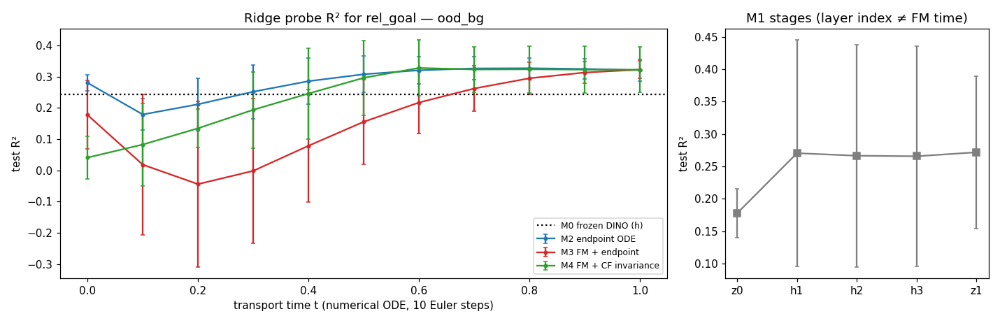
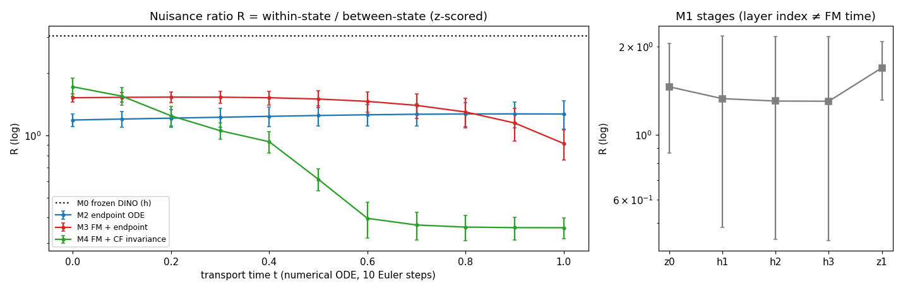
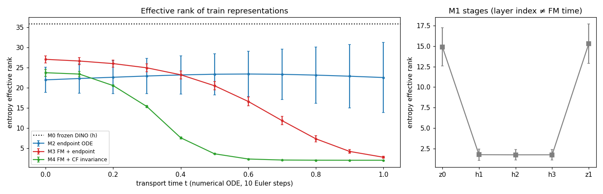
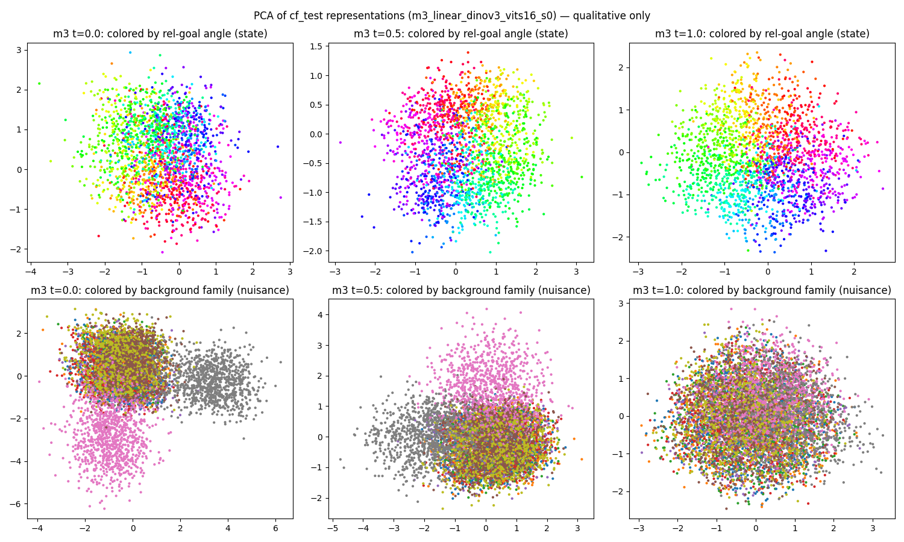
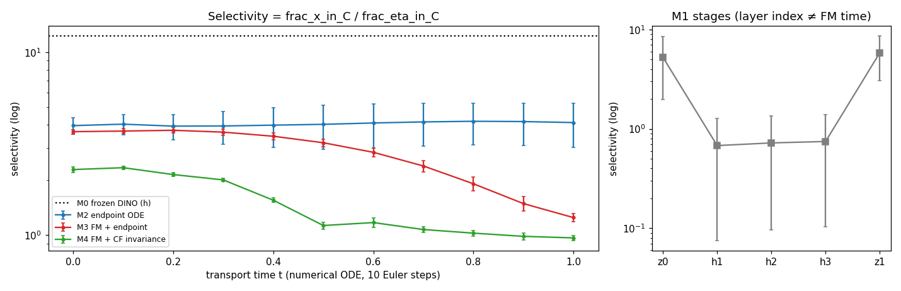
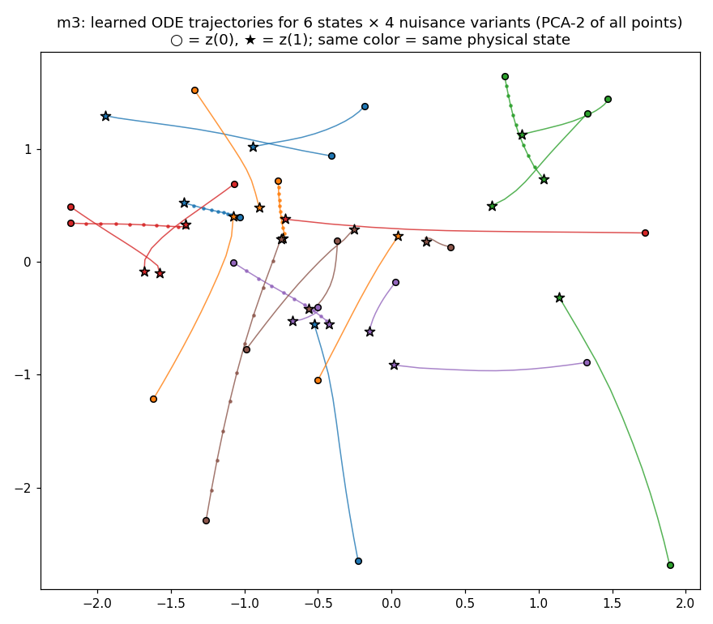
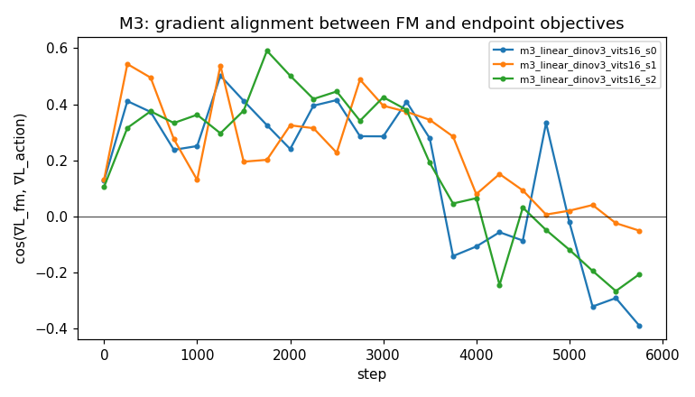

# 03 — Mechanism analysis: what (if anything) does cross-modal FM do to the representation?

Sources: `results/metrics/{probes,invariance,subspaces,sensitivity,sensitivity_frac0.1}.csv`, produced by
`python -m cort_mvp.analysis.{probes,invariance,subspaces,sensitivity}` on the exported representations in
`results/representations/<run>/<split>.npz`; tables in `reports/tables/table_*.md`; figures in `results/figures/`.
All stage-wise numbers are mean ± std over the 3 main seeds. "Stage" means:

* M2/M3/M4: the ODE state `z(t)` at `t ∈ {0, 0.1, …, 1}` obtained by **10-step Euler integration of the trained field**
  (independent of the 8-step training grid, so `t = 1` here is a numerical endpoint, not the training endpoint);
* M1: `z0` (projector output), `h1–h3` (residual stream after each `SimpleFlowNet` block), `z1` (output). Layer index is
  **not** an analogue of transport time; the right-hand panel of every figure keeps M1 separate on purpose;
* M0: the frozen DINOv3 CLS feature `h` (384-d). Everything else is 64-d.

All probes/ratios are computed on **test** states; probes are fit on 4 000 train states (`RidgeCV`, 5-fold α selection;
MLP(64) with early stopping on a train-internal split). Nothing is selected on OOD data.

## 1. Linear decodability of the control state (Q1, representation part)

Ridge probe test R² for the relative goal `goal − ee` (identical to the pre-clipping action), `reports/tables/table_probe_ridge_relgoal_*.md`:

| stage | id_test | ood_bg | geo_ood (nMSE) |
|---|---|---|---|
| M0 frozen CLS | 0.590 | 0.243 | 1.50 |
| M1 z0 | 0.578 ± 0.021 | 0.178 ± 0.038 | 1.53 |
| M1 z1 (all 3 seeds) | 0.706 ± 0.089 | 0.272 ± 0.117 | 1.19 |
| M1 z1 (stable seeds 0, 1) | 0.759 / 0.755 | 0.331 / 0.348 | 1.05 / 1.06 |
| M2 t=0 | 0.568 ± 0.004 | 0.280 ± 0.026 | 1.59 |
| M2 t=0.5 | 0.730 ± 0.025 | 0.307 ± 0.058 | 1.17 |
| M2 t=1 | 0.748 ± 0.004 | 0.321 ± 0.035 | 1.13 |
| M3 t=0 | 0.574 ± 0.003 | 0.177 ± 0.110 | 1.55 |
| M3 t=0.5 | 0.734 ± 0.006 | 0.155 ± 0.135 | 1.07 |
| M3 t=1 | 0.755 ± 0.001 | 0.322 ± 0.028 | 1.06 |
| M4 t=1 (positive control) | 0.778 ± 0.006 | 0.322 ± 0.073 | 1.01 |

* Every trained head raises linear decodability over the frozen feature (0.59 → 0.75 ID). **M3's endpoint is not more
  linearly decodable than M2's (0.755 vs 0.748) or than a converged M1 (0.759 / 0.755).** On unseen backgrounds all
  three are at 0.32–0.35; on the geometric hold-out all probes are worse than predicting the mean (nMSE > 1; the
  hold-out box has small target variance and probes extrapolate poorly), with M3/M4 closest to 1.
* Decodability of the *absolute* state (ee and goal positions, `table_probe_ridge_stateabs_id_test.md`) behaves
  differently: M2 keeps it (0.54 → 0.64), M3 **loses** it at the end of transport (0.55 → 0.62 at t=0.5 → 0.44 at t=1),
  M4 likewise (0.59 → 0.55). This is the first sign of the dominant FM effect — collapse onto the action plane (§3).
* MLP(64) probes (`table_probe_mlp_relgoal_ood_bg.md`) do not change the ranking (M2 0.20, M3 0.25, M1 0.17–0.28, M4 0.33
  on ood_bg; large seed spread).

**Answer to the decodability half of Q1: no.** FM does not make the control state more linearly decodable than matched
regression or endpoint-only ODE training; the gain over the frozen feature is produced by *any* supervised head.

## 2. Nuisance sensitivity under matched physical states (Q2)

Counterfactual pairs (`cf_test`: identical state, 4 nuisance draws, 2 seen + 2 unseen background families) versus
same-nuisance state changes (`sp_test`). `R = within / between`, with `within = mean ‖z(v_i) − z(v_j)‖²` over the 6
variant pairs and `between = mean ‖z(cf_v0) − z(sp_v1)‖²` for an independent state under the same nuisance. Reported
raw and after per-dimension z-scoring with the train statistics of the same stage (so that rank collapse does not
trivially shrink `R`). Table `table_invariance.md`:

| stage | z-scored R | raw R | z-R unseen pairs | z-within | z-between | train erank | train total var |
|---|---|---|---|---|---|---|---|
| M0 frozen CLS | 3.03 | 3.08 | 3.06 | 742 | 245 | 35.8 | 24.1 |
| M1 z1 | 1.69 ± 0.38 (stable seeds 1.53 / 1.42) | 1.50 ± 0.59 | 1.78 ± 0.14 | 109 | 67 | 15.3 | 69 |
| M2 t=0 | 1.19 ± 0.08 | 1.14 ± 0.13 | 1.33 | 97 | 82 | 21.9 | 46 |
| M2 t=1 | 1.27 ± 0.20 | 1.15 ± 0.29 | 1.44 | 102 | 81 | 22.5 | 41 |
| M3 t=0 | 1.52 ± 0.07 | 1.45 ± 0.08 | 1.92 | 135 | 88 | 27.0 | 10.1 |
| M3 t=0.5 | 1.50 ± 0.14 | 1.33 ± 0.12 | 1.99 | 139 | 93 | 20.5 | 3.8 |
| M3 t=1 | 0.91 ± 0.15 | 0.58 ± 0.05 | 1.25 | 92 | 101 | 2.75 | 2.0 |
| M4 t=1 | 0.36 ± 0.04 | 0.36 ± 0.04 | 0.44 | 40 | 113 | 2.0 | 1.8 |

Observations:

1. **Frozen DINOv3 CLS is strongly nuisance-dominated** (R ≈ 3: two images of the *same* state under different nuisance
   are three times further apart than two different states under the same nuisance). Every trained head reduces this to
   R ≈ 1.2–1.7 already at `z0`, i.e. the linear projector trained through any of the losses removes most of it.
2. **M3's ratio only drops at the very end of transport** (1.52 at t = 0, 1.50 at t = 0.5, 1.15 at t = 0.9, 0.91 at
   t = 1), and the drop coincides exactly with the **collapse of the representation onto the 2-D action plane**: effective
   rank 27 → 2.75, total variance 10 → 2, fraction of state-difference energy inside `span(W)` 0.15 → 0.96
   (`table_subspaces.md`). In raw coordinates `within` shrinks 10× (20.6 → 1.9) but `between` shrinks 4× (14.2 → 3.3),
   so raw R falls to 0.58; after z-scoring the picture is: `within` 135 → 92, `between` 88 → 101.
3. **At matched effective rank there is no advantage.** M3 at t = 0.5 (erank 20.5, comparable to M2's 22) has
   z-scored R = 1.50 ± 0.14 versus M2's 1.25 ± 0.14 — *worse*. M3's `z0` (1.52) is also worse than M2's `z0` (1.19) and
   its unseen-family ratio at t = 0 (1.92) is the highest of all trained models: the FM loss shapes the projector so that
   unseen background families form **separate clusters in the top principal components of `z0`** (fig. 6, bottom-left),
   which are only folded away as the state approaches the action plane. M2's `z0` does not show these clusters.
4. **At t = 1 the representation is the prediction.** With 96 % of state energy and 77 % of nuisance energy in `span(W)`,
   `z(1)` is essentially `W â`, and its nuisance sensitivity *is* the nuisance sensitivity of the predicted action — which
   is identical for M1, M2 and M3 (`cf_consistency` 0.50–0.51, `02_baseline_results.md`). Nothing has been "removed";
   the residual nuisance variation is exactly the part that corrupts the action.
5. **The positive control behaves as designed** (R 1.72 → 0.36, collapsing from t ≈ 0.4), which confirms the metric can
   detect genuine invariance when it is trained for; M3 does not reach it, and M4 still predicts actions with
   `cf_consistency` 0.47 and `0.57` on unseen pairs — explicit invariance on seen backgrounds transfers only weakly to
   unseen families.

**Answer to Q2: no, not in the sense the hypothesis intended.** Relative to matched controls, FM does not reduce nuisance
sensitivity at comparable representational rank. The lower ratio at t = 1 is a by-product of transporting every point onto
the 2-D action plane, and at that point the ratio is a re-statement of the (model-independent) action-level nuisance error.

## 3. Where along transport do changes happen (Q3)

* **Decodability** rises smoothly and saturates: 80 % of the M3 gain (0.57 → 0.76) is reached by t = 0.5; after that the
  probe R² is flat while the geometry keeps changing.
* **Geometry** changes late: erank is flat until t ≈ 0.3 and collapses between t = 0.4 and t = 0.9
  (27 → 4); `frac_x_in_W` 0.15 → 0.42 (t = 0.5) → 0.96 (t = 1); the fraction of *nuisance* energy inside the control
  subspace `C` (ridge weights) rises from 0.04 to 0.47, so selectivity `frac_x_in_C / frac_eta_in_C` falls 3.7 → 1.25,
  whereas M2 stays at ≈ 4 for all t. Late transport therefore makes nuisance and state differences *more* aligned with
  the control-readout directions, not less.
* **A transient early-time degradation on unseen backgrounds**: M3's ood_bg probe R² dips from 0.18 (t = 0) to −0.04 at
  t = 0.2 and only recovers past the t = 0 value at t ≈ 0.6 (fig. 3, ood_bg). M2 is monotone. The velocity field learned
  by FM is poorly calibrated for OOD inputs at small t.
* **Gradient interaction** (`fig10_grad_cosine.png`, logged every 250 steps): the FM and endpoint gradients on shared
  parameters are *cooperative* for the first ≈ 3 000 steps (cos ≈ 0.3–0.5) and become *conflicting* afterwards
  (cos < 0 from ≈ step 3 500–4 500 on, down to −0.4). The best validation checkpoints of M3 are at steps 3 500–4 000 —
  the point at which the two objectives start to disagree. This is consistent with over-fitting of the endpoint term
  (train action loss → 0, `02_baseline_results.md`) rather than with a representational benefit of the FM term.
* Trajectories in PCA (fig. 8) are smooth, mildly curved paths for M3 (straightness in the full 64-d space is what the
  step sweep in `02_baseline_results.md` §3 measures, not the 2-D projection); nuisance variants of the same state (same colour)
  start far apart and end close together, but so do *different* states — the end-points lie in a 2-D disc.

**Answer to Q3:** decodability changes are front-loaded (t ≤ 0.5) and shared with M2; the FM-specific geometric changes
(rank collapse, alignment with `span(W)`, drop in R) happen at t ≥ 0.5 and are explained by the target of the transport
being 2-dimensional.

## 4. Can endpoint supervision or the architecture alone explain it (Q4)

| property | M1 (same net, t ≡ 0) | M2 (same net, endpoint-only ODE) | M3 (FM + endpoint) |
|---|---|---|---|
| action MSE id / ood_bg / geo | 0.103 / 0.26–0.27 / 0.24 (stable seeds) | 0.109 / 0.287 / 0.276 | 0.1035 / 0.280 / 0.252 |
| linear decodability rel_goal id / ood_bg | 0.76 / 0.33–0.35 (stable) | 0.75 / 0.32 | 0.755 / 0.32 |
| z-scored nuisance ratio at output | 1.4–1.5 (stable) | 1.27 | 0.91 (rank 2.75) |
| effective rank at output | 12.5–17 | 22.5 | 2.75 |
| integration-step robustness (1 step) | n/a | 4.6 (fails) | 0.111 |
| seed stability at selected LR | 1 of 3 seeds diverged | stable | stable |

* Everything that looks like a representational improvement over the frozen feature (decodability, R ≈ 3 → 1.2–1.7, removal
  of nuisance PCs) is reproduced by **M1 and M2**, which share the architecture and the endpoint supervision but have no
  FM loss. The architecture-only control (M2) is in fact *more* nuisance-selective in the control subspace than M3.
* What the FM loss adds that the controls do not reproduce: (i) a **velocity field that is approximately straight**, hence
  one Euler step already gives a usable prediction and 16 steps change nothing, and (ii) the **collapse of z(1) onto the
  2-D action plane** (M2 keeps 22 dimensions alive and `frac_x_in_W` ≈ 0.06 at t = 1 — its endpoint satisfies `Wᵀz₁ ≈ a`
  without lying in `span(W)`). Both are direct consequences of the FM regression target `u = W a − z₀`, not emergent
  representation learning.
* The loss-decomposition ablation B (`fm_only`, `endpoint + embedding loss`, `M1 + embedding loss`) tests whether the
  collapse / robustness can be obtained with an explicit `‖z₁ − W a‖²` term instead of FM — see §6 (filled after the
  ablation suite).

**Answer to Q4: yes.** On this benchmark the representational changes that matter for control (decodability, nuisance
ratio at matched rank, OOD action error) are explained by endpoint supervision on the shared architecture. The residual
FM-specific effects are geometric (straightness of the field, confinement to the action plane).

## 5. Unseen background distributions (Q5)

* Probe R² on `ood_bg`: M3 = M2 = 0.32 ± 0.03, converged M1 0.33–0.35, frozen 0.24. No FM-specific gain.
* z-scored R restricted to unseen–unseen pairs: M1 1.78, M2 1.44, M3 1.25 (t = 1, collapsed) / 1.92–1.99 (t ≤ 0.5),
  M4 0.44. The same rank caveat as in §2 applies; at matched rank M3 is the *most* sensitive to unseen backgrounds.
* Action-level nuisance consistency on unseen pairs: M1 0.66 ± 0.06, M2 0.67 ± 0.06, M3 0.62 ± 0.06, M4 0.57 ± 0.08 —
  overlapping intervals.
* Finite-difference sensitivity (§6.3 of the plan; `table_sensitivity_frac0.1.md`): with a 10 % step in each factor the
  ratio `‖J_η‖/‖J_x‖` is **0.78–0.84 for every trained model and every stage** (frozen feature 0.92, M4 0.79–0.81). The heads
  rescale both Jacobians together (M3 shrinks both ≈ 3× along transport) but none changes their *ratio*. Local sensitivity
  to continuous nuisance (hue, saturation, texture frequency/phase/angle) relative to state is fixed by the frozen
  backbone. Methodological note: with the planned 1 % step the per-unit-range Jacobian norms are ≈ 5× larger than with
  10 % and the ratio is 0.51–0.56 for all models, i.e. the rendered-image → DINO map is not locally linear at 2-pixel
  perturbations (anti-aliasing / texture sampling); we therefore report the 10 % step as the primary number and keep both
  tables.

**Answer to Q5:** there is no FM-specific representation effect on unseen backgrounds to generalise; the (shared)
supervised gain over frozen features does transfer partially (probe R² 0.24 → 0.32), and the privileged M4 shows that even
explicit invariance supervision transfers weakly through frozen features.

## 6. Ablations relevant to the mechanism (A–F)

_Filled from `reports/tables/table_ablations_action.md` and the per-run analysis CSVs after the ablation suite finished —
see the end of this file._

## 7. Caveats and recorded anomalies

* **M1 intermediate stages.** With `t ≡ 0` the time-modulated adaLN blocks of `SimpleFlowNet` learn gains up to 4·10⁴ and the
  residual stream reaches 10⁷–10¹⁰ (effective rank ≈ 2) while the final `LayerNorm` keeps outputs normal. `h1–h3`
  therefore carry a single giant direction; their z-scored probe R² (0.68) and ratios are reported for completeness but
  not interpreted. `z0` and `z1` are unaffected.
* **Rank collapse confounds any "nuisance ratio" comparison** between models whose endpoint lies in a 2-D plane (M3, M4)
  and models whose endpoint does not (M1, M2). We therefore report numerator and denominator, raw and z-scored, the
  effective rank, and compare at matched rank (t = 0.5 for M3).
* **Over-fitting.** All heads drive the training action loss to ≈ 0; every number above is a generalisation-gap number
  under in-distribution early stopping.
* `geo_ood` probe R² is negative for all models because the hold-out box has small target variance; nMSE is reported instead.
* Only one backbone size (ViT-S) and one synthetic task were used; see `02_baseline_results.md` §4 for DINOv2 and
  dataset-size ablations.

## 8. Verdict (Q1–Q5 in one paragraph)

On a controlled synthetic reaching task with frozen DINOv3 features, parameter-matched heads and fair LR selection,
cross-modal Flow Matching **does not act as a distinctive mechanism for learning control-oriented or nuisance-robust visual
representations**. Its endpoint is as accurate and as linearly decodable as that of direct regression (when the latter
converges) and marginally (≈ 5 %) better than endpoint-only ODE training; its nuisance ratio is not lower at matched rank;
its local sensitivity ratio is identical; and nothing FM-specific transfers to unseen backgrounds. What FM demonstrably
adds is (a) a near-straight, integration-step-robust velocity field, (b) confinement of the final state to the 2-D action
plane, and (c) better seed-stability than the regression head at its selected LR. The outcome is **negative** in the
sense of the plan's §11 ("properly matched regression or endpoint ODE achieves equivalent results"), with the
step-robustness result as the one clearly positive, FM-specific finding.
